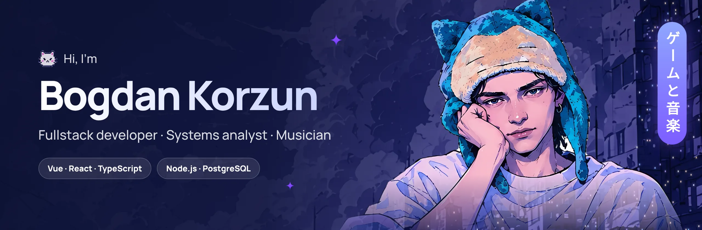
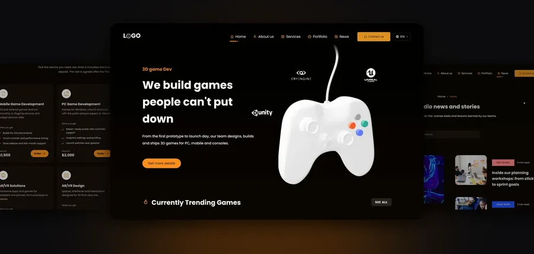
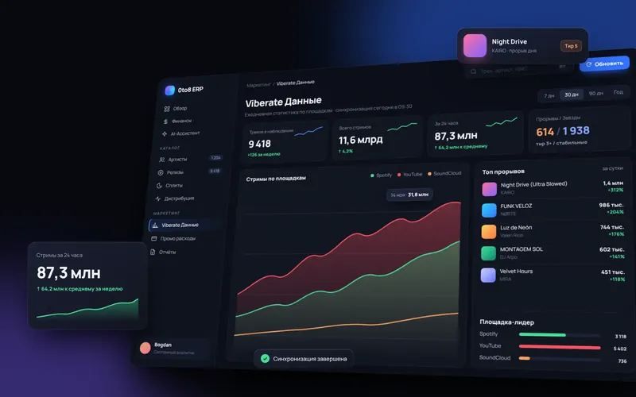
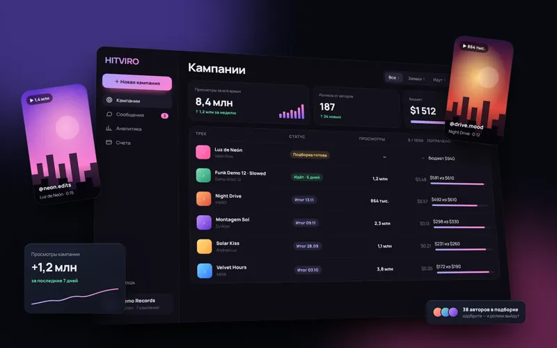
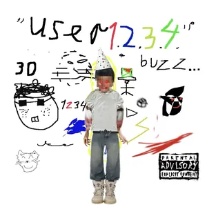

<picture>
  <source media="(prefers-color-scheme: dark)" srcset="assets/banner-dark.webp">
  <source media="(prefers-color-scheme: light)" srcset="assets/banner-light.webp">
  
</picture>

  
  
  
  
  

## About

I'm a fullstack developer and systems analyst at **Zero to Infinity**, a music label. I build the label's ERP, Telegram bots and internal services: from figuring out what the team actually needs to shipping the interface, the API and the database behind it.

Outside of work I build side projects to learn things properly, and I write and release my own music.

## Projects

<table>
  <tr>
    <td width="50%" valign="top">
      
      <h3>1234 · personal site</h3>
      
My portfolio in a hand-drawn anime style: projects, music with its own player, light and dark themes, Russian and English. Fast on phones and covered with unit, end-to-end and accessibility tests.

      
<code>Vue 3</code> <code>TypeScript</code> <code>Vite</code> <code>Vitest</code> <code>Playwright</code>

      <a href="https://user1234-code-maker.github.io/1234-site/"><b>Open site</b></a> · <a href="https://github.com/User1234-Code-maker/1234-site">Source</a>
    </td>
    <td width="50%" valign="top">
      
      <h3>Game Studio Website</h3>
      
Started as a hand-coded layout from a Figma mockup, grew into a full app: React front end, Express API, PostgreSQL, Stripe test payments, a 3D gamepad on the first screen and CI with API and end-to-end tests.

      
<code>React</code> <code>TypeScript</code> <code>Node.js</code> <code>PostgreSQL</code> <code>Stripe</code>

      <a href="https://game-studio-site.onrender.com"><b>Live demo</b></a> · <a href="https://github.com/User1234-Code-maker/game-studio-site">Source</a>
    </td>
  </tr>
</table>

## Work under NDA

The code is private, so here is what these products look like. Screens are redrawn after the real ones and all the data on them is made up.

<table>
  <tr>
    <td width="50%" valign="top">
      
      <b>ERP for a music label</b> 
      Distribution, support, documents, finance and streaming analytics in one system. React 19, AG Grid, NestJS, PostgreSQL, ClickHouse.
    </td>
    <td width="50%" valign="top">
      
      <b>Hitviro</b> 
      A platform where the label orders promo videos from creators. I handle analytics and payouts.
    </td>
  </tr>
  <tr>
    <td width="50%" valign="top">
      
      <b>Telegram bots and mini app</b> 
      Internal bots for distribution, support and payments, plus a mini app for scouting tracks. Node.js, Telegraf, Redis.
    </td>
    <td width="50%" valign="top">
      
      <b>Music recognition</b> 
      A service that finds which track plays in a video by link and collects stats on videos and releases.
    </td>
  </tr>
</table>

## Stack

<table>
  <tr>
    <td><b>Front end</b></td>
    <td>
      
      
      
      
      
      
      
    </td>
  </tr>
  <tr>
    <td><b>Back end</b></td>
    <td>
      
      
      
      
    </td>
  </tr>
  <tr>
    <td><b>Data</b></td>
    <td>
      
      
      
      
    </td>
  </tr>
  <tr>
    <td><b>Quality and delivery</b></td>
    <td>
      
      
      
      
    </td>
  </tr>
</table>

## Music

I write, record and release my own tracks. The album **1234** came out in March 2026, and the latest singles followed in the autumn. You can listen right on [my site](https://user1234-code-maker.github.io/1234-site/music) or on [SoundCloud](https://soundcloud.com/user1234user1234user1234).

 

## Right now

- Building ERP features and internal tools at Zero to Infinity
- Going deeper into back end, databases and deployment through side projects
- Open to talking about interesting projects: the fastest way is [Telegram](https://t.me/OpalineDream)

